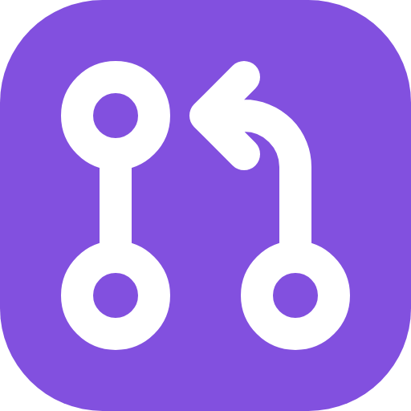
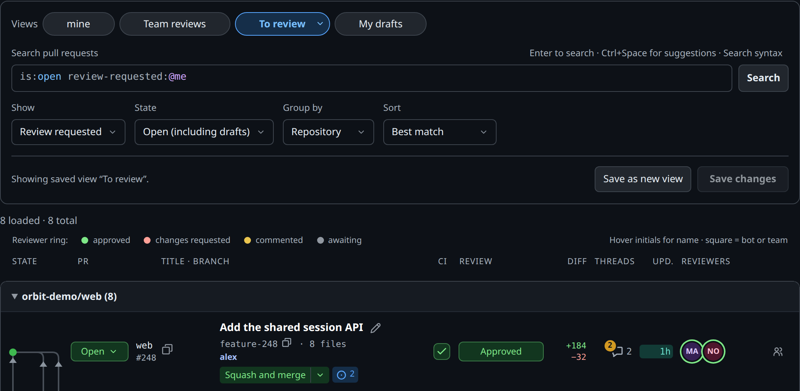
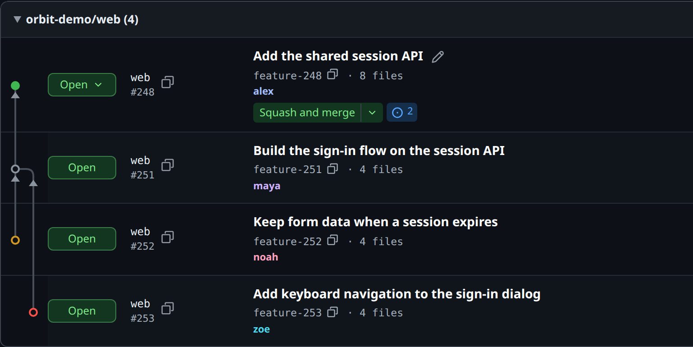
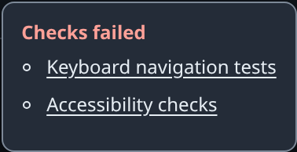
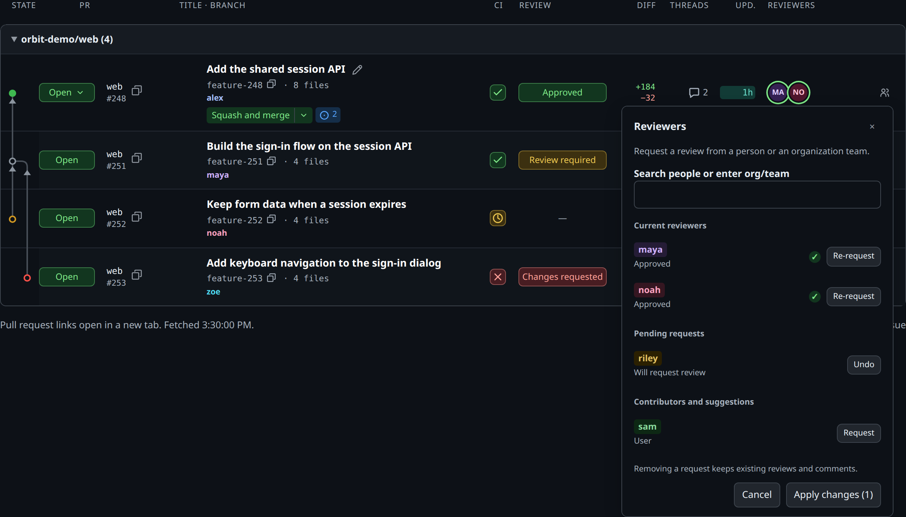
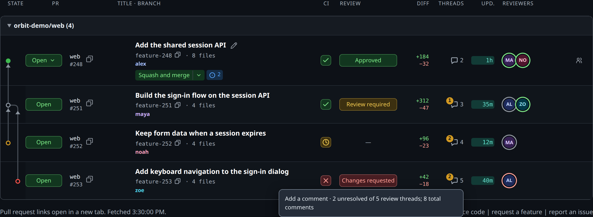
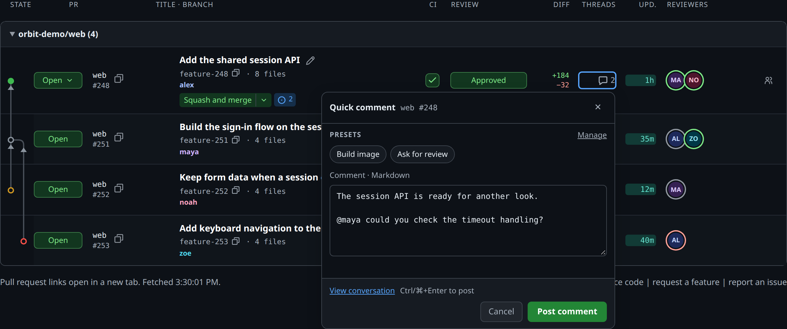
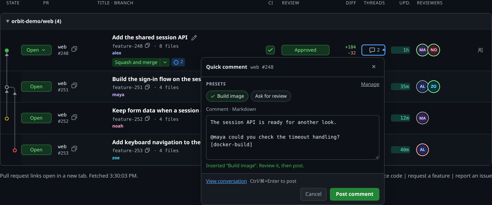

#  gh-pull

**Your pull requests. One clear view.**

A local dashboard for GitHub CLI. Find your next review, follow stacked PRs, and get straight to failing checks—all with your existing GitHub login.

[Get started](#github-cli-extension) · [Watch the dashboard tour](https://youtu.be/LfIj6tZMKWM) · [Full dashboard](docs/demo.png) · [Usage guide](docs/usage.md)

## Features

### Find your focus. Save it for tomorrow.

Search across repositories with GitHub qualifiers and autocomplete. Save your go-to searches as one-click views, then group PRs by repository, author, status, or checks.



### See the stack. Know what comes next.

Follow branch dependencies at a glance. Connected lanes keep parent and child PRs together—even when a stack branches.



### Find the failure. Jump to the job.

Hover a failed CI badge to see which checks broke, then open the job directly. Running checks show progress without leaving the dashboard.



### Keep reviews moving.

See who approved, who requested changes, and who’s still to review. Request or re-request reviews on your own PRs, with changes held until you apply them.



### See what still needs an answer.

Amber thread badges flag unresolved review feedback beside each PR’s total thread count. Hover for the breakdown, so you can spot the conversations that still need attention.



### Reply while it’s fresh.

Spot unresolved review threads and leave a quick Markdown comment from the dashboard. Drafts stay with you while you work.



### Reuse a comment without posting it twice.

Save a bot trigger or review request in **Settings → Quick comment presets**. Open a PR’s Threads cell and pick a matching preset to insert it into your draft. Review the text, then post. [Follow the step-by-step quick comment presets guide](docs/quick-comment-presets.md) to create a preset, choose its repositories, reorder it, or undo a deletion.



Plus automatic refresh, new-update highlights, linked issues, branch copying, and light and dark themes. On your own PRs, edit titles, manage draft status, or merge eligible changes.

Screenshots use fictional PRs. See the [usage guide](docs/usage.md) for shortcuts, permissions, and details.

## Get started

**Run `gh pull`. Get back to your work.** No Node installation, source checkout, or separate GitHub App installation needed with the CLI extension.

Both the extension and [local app from source](#local-app-from-source) use your GitHub CLI login or a personal access token. You can access the repositories your credentials allow, subject to your organization's token and SSO policies. A **GitHub.com** account is required; GitHub Enterprise hosts are not supported.

## GitHub CLI extension

Install [GitHub CLI](https://cli.github.com/) if needed, then run:

```sh
gh auth login --hostname github.com  # Skip if already signed in
gh extension install shiqicao/gh-pull
gh pull
```

`gh pull` starts the dashboard in the background and opens your browser. Running it again reopens the same instance. No clone, Node installation, or GitHub App installation is needed. Closing the browser leaves the dashboard running until you stop it or shut down your computer; it does not register a system startup service.

```sh
gh pull --no-open          # Print the URL without opening a browser
gh pull status            # Show the running instance
gh pull stop              # Stop the dashboard
gh pull --port 3456        # Use a specific port
gh pull --foreground      # Keep it in the terminal; Ctrl+C stops it
gh pull --version
gh pull --licenses
```

The extension listens only on `127.0.0.1`. It prefers port 3000 and chooses a free port if needed. An explicit `--port` fails if occupied. It inherits `GH_TOKEN` / `GITHUB_TOKEN` when supplied; otherwise it uses `gh auth token --hostname github.com`.

The dashboard footer shows the running extension's version, with release versions linked to their GitHub release. You can also check the installed version with `gh pull --version`.

Stable extension builds check GitHub for a newer stable release when the dashboard opens and hourly while visible. An update notice links to the release and shows the upgrade command. Checks use GitHub's public API without credentials, are cached for an hour across tabs, and quietly tolerate connection failures. Development and prerelease builds skip update checks.

Update with `gh pull stop`, `gh extension upgrade pull`, then `gh pull` to start the new version. Also restart after switching GitHub accounts or changing token environment variables. Stop before uninstalling with `gh extension remove pull`.

Release builds target Linux and macOS (Intel/AMD and ARM64), and Windows x64. Private instance-control state is stored under the user's platform data directory (`~/.local/state/gh-pull` on Linux, `~/Library/Application Support/gh-pull` on macOS, or `%LOCALAPPDATA%\gh-pull` on Windows). It contains a local control token, not your GitHub token. `GH_PULL_STATE_DIR` can override this directory for testing or isolated instances.

## Local app from source

Requires **Node.js 22+**, plus either GitHub CLI authentication or a personal access token. No npm dependencies or build step are needed to run the app.

```sh
git clone https://github.com/shiqicao/gh-pull.git
cd gh-pull
gh auth login --hostname github.com  # Skip if already signed in
npm start
```

Open <http://localhost:3000>. Local mode is the default (`AUTH_MODE=local`). The server uses your GitHub CLI credentials, or `GH_TOKEN` / `GITHUB_TOKEN` if supplied. It binds only to `127.0.0.1`; credentials stay on the server.

`npm start` and `npm run dev` restart the server when backend files change. Reload the browser after frontend edits. Use `node server.js` to run without automatic restarts.

## Local configuration

| Setting | Applies to | Description |
| --- | --- | --- |
| `GH_TOKEN` / `GITHUB_TOKEN` | Both | Optional token; takes precedence over your GitHub CLI login |
| `--port PORT` | Extension | Select a port explicitly; otherwise tries 3000, then an available port |
| `--config PATH` | Extension | Use a saved-views JSON file instead of the default XDG config path |
| `GH_PULL_STATE_DIR` | Extension | Override the directory containing instance-control state |
| `PORT` | Source | Server port; defaults to 3000 |
| `AUTH_MODE=local` | Source | Local authentication; this is the default |

For a custom saved-views file, run `gh pull --config /path/to/saved-views.json`. Relative paths resolve from your current directory; `~/` expands to your home directory. The file uses the existing saved-views JSON format, not environment variables or startup settings. Missing files and parent directories are created on first save; unreadable or invalid files fail at startup. To change files, run `gh pull stop` first. Running `gh pull` without `--config` reopens the current dashboard, including its custom file; after stopping it, omitting the flag uses the default again.

Credentials stay in the local backend and are never sent to the browser. Both options bind only to `127.0.0.1`. The extension uses `--port`, not the source server's `PORT` environment variable.

`npm start` reads environment variables from your shell. If you prefer a `.env` file, use `node --env-file=.env server.js`; `.env` files are ignored by Git.

## Local data and privacy

PRs load in pages of 50, with a 25-second server cache keyed by query and cursor. Tabs share cached results and requests already in flight. Manual refresh bypasses completed cached results; background refresh reuses them. Refresh preserves loaded pages. Local edits notify other open tabs to refresh. Searches run against GitHub; grouping applies to loaded pages. All dashboard searches, including Created by me, expose at most 1,000 matches, with a notice when that limit applies. Narrow the query by repository or date to find more specific results.

Labels include the first ten per PR. Reviewers include up to 100 review requests and 100 latest reviews, with a GitHub link when more exist. Check status and counts describe the latest commit's check runs and commit statuses.

Browser storage holds name colors and account-specific viewed PR IDs/timestamps, not PR contents or credentials. Without browser storage, tracking lasts only for the current page. Reading PRs directly on GitHub does not mark them as viewed here.

PR results are cached in memory by the local process and cleared when it stops. With the extension, closing the browser leaves the process running; use `gh pull stop` to end it. Automatic refresh runs in the browser, so closing the dashboard stops its polling.

See the [Privacy Policy](PRIVACY.md), [Third-party services](THIRD_PARTY_SERVICES.md), and [Transparency disclosures](TRANSPARENCY.md) for further details on data handling and security.

## Development

### Verify

```sh
npm ci
npm run check
npm test
```

Tests use Node's built-in test runner and mocked GitHub responses. They cover PR behavior, CLI lifecycle and control access, authentication, and request validation using local fixture servers and mocked responses, without real GitHub credentials.

Browser interaction tests use Playwright with isolated fixture PRs. They cover editing, draft/ready changes, merges, read tracking, clipboard feedback, query autocomplete and keyboard editing, synchronized presets, pagination, stale responses, background refresh, and light/dark mobile layouts. All mutations stay in the fixture server; external browser requests are blocked.

```sh
npm ci
npx playwright install chromium
npm run test:browser
```

To use an existing Chrome installation instead, set `CHROME_BIN` to its executable path when running `npm run test:browser`. Browser screenshots are written to `/tmp/gh-pull-query-browser` (override with `BROWSER_ARTIFACT_DIR`).

Regenerate the six README component screenshots with `node scripts/capture-dashboard.mjs --readme` (or set `CHROME_BIN` as above). Add `--video` to record a captioned, silent `docs/demo.mp4` as well (requires `ffmpeg` with the subtitles filter). The video is ignored by Git; upload it to YouTube and update the tour link above. Omit `--readme` to also update the full dashboard images (`docs/demo.png` and `docs/marketplace-dashboard.png`). Captures use fictional PRs, isolated saved views, a fixed clock, and local responses; external browser requests are blocked.

For optional narration, set `GH_PULL_NARRATION_DIR` to a directory containing `scenes.json`: an array of eight objects in tour order, each with `text`, `duration` in seconds, and an absolute audio-file `path`. The recorder uses these local audio clips to time the scenes and captions; it does not generate speech.

### Frontend organization

Our editor integration lives in `public/query-editor.js`; the shared query model lives in `public/query.js`. Both are ordinary source files and can be edited without rebuilding. Generated third-party code and its license notices live separately in `public/vendor/`. Dependency lanes use SVG.js to draw continuous SVG paths and resize with the rows. Parent lookups are batched and cached for one minute; failures leave the loaded results available.

Shared colors and sizing live in `public/theme.css`, dashboard and reusable component styles in `public/style.css`, and query editor styles in `public/query-editor.css`. Use the shared theme variables when adding UI components so light and dark modes stay consistent.

After updating CodeMirror or SVG.js dependencies or the exported APIs in `scripts/vendor/`, run `npm run build:vendor` and commit the generated files. CodeMirror, esbuild, and Playwright are development dependencies; running the server does not require installing them. The editor and vendor bundle load when the dashboard starts.

### Developing the CLI extension

Run `npm ci` and `npm run cli -- --no-open` to try the launcher from source. Use `npm run cli -- stop` to stop it.

`npm run build:extension` builds a native standalone executable into `dist/`, embedding the UI, backend, Node runtime, and license notices. It uses Node's single-executable application support, esbuild, and postject; use Node 24.18.0 to match CI. The build fetches the matching Node license and leaves generated intermediates in `.build/`. `npm run test:extension` checks the actual binary and local GitHub CLI installation with isolated state and fake credentials. `npm run test:extension:browser` checks its browser UI on Linux using Playwright and fixture responses.

The extension workflow tests native builds on each supported platform. Version tags (`v*`) publish the tested binaries as GitHub release assets; pull requests only build and test artifacts. Published binaries are available on the [Releases page](https://github.com/shiqicao/gh-pull/releases).

## License

[MIT](LICENSE) © 2026 shiqicao. Third-party attribution and license terms are listed in [THIRD_PARTY_NOTICES](THIRD_PARTY_NOTICES).
