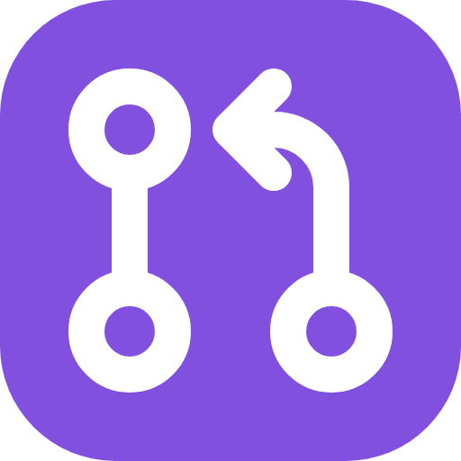
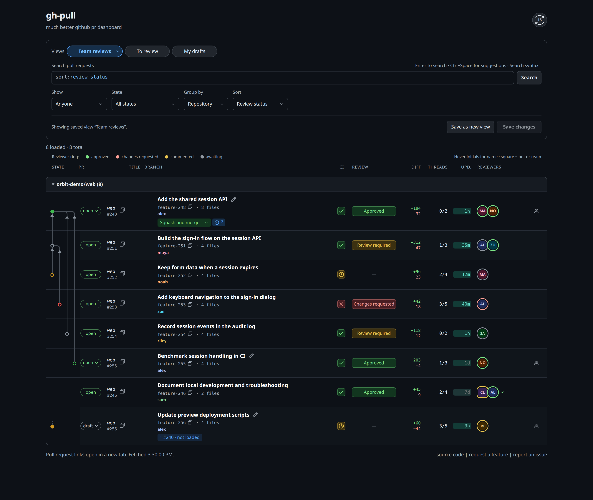

#  gh-pull

**A local pull request dashboard for GitHub CLI**

Organize PRs across repositories, track reviews and checks, and manage your work in the browser using your existing GitHub login.

Choose how to run it:

- **[GitHub CLI extension](#github-cli-extension) — recommended:** Install once, then run `gh pull`. No Node installation or source checkout needed.
- **[Local app from source](#local-app-from-source):** Clone the repository and run it with Node.js. Useful for development and customization.

Both use your existing GitHub CLI login or a personal access token. No separate GitHub App installation is required. You can access the repositories your credentials allow, subject to your organization's token and SSO policies. A **GitHub.com** account is required; GitHub Enterprise hosts are not supported.

[](https://raw.githubusercontent.com/shiqicao/gh-pull/refs/heads/main/docs/demo.png)

[▶ Watch the quick tour](https://youtu.be/4LBga5H5Wwk) · 81 seconds · narrated with captions

## GitHub CLI extension

Install [GitHub CLI](https://cli.github.com/) if needed, then run:

```sh
gh auth login --hostname github.com  # Skip if already signed in
gh extension install shiqicao/gh-pull
gh pull
```

`gh pull` starts the dashboard in the background and opens your browser. Running it again reopens the same instance. No clone, Node installation, or GitHub App installation is needed. Closing the browser leaves the dashboard running until you stop it or shut down your computer; it does not register a system startup service.

```sh
gh pull --no-open          # Print the URL without opening a browser
gh pull status            # Show the running instance
gh pull stop              # Stop the dashboard
gh pull --port 3456        # Use a specific port
gh pull --foreground      # Keep it in the terminal; Ctrl+C stops it
gh pull --version
gh pull --licenses
```

The extension listens only on `127.0.0.1`. It prefers port 3000 and chooses a free port if needed. An explicit `--port` fails if occupied. It inherits `GH_TOKEN` / `GITHUB_TOKEN` when supplied; otherwise it uses `gh auth token --hostname github.com`.

The dashboard footer shows the running extension's version, with release versions linked to their GitHub release. You can also check the installed version with `gh pull --version`.

Stable extension builds check GitHub for a newer stable release when the dashboard opens and hourly while visible. An update notice links to the release and shows the upgrade command. Checks use GitHub's public API without credentials, are cached for an hour across tabs, and quietly tolerate connection failures. Development and prerelease builds skip update checks.

Update with `gh pull stop`, `gh extension upgrade pull`, then `gh pull` to start the new version. Also restart after switching GitHub accounts or changing token environment variables. Stop before uninstalling with `gh extension remove pull`.

Release builds target Linux and macOS (Intel/AMD and ARM64), and Windows x64. Private instance-control state is stored under the user's platform data directory (`~/.local/state/gh-pull` on Linux, `~/Library/Application Support/gh-pull` on macOS, or `%LOCALAPPDATA%\gh-pull` on Windows). It contains a local control token, not your GitHub token. `GH_PULL_STATE_DIR` can override this directory for testing or isolated instances.

## Local app from source

Requires **Node.js 22+**, plus either GitHub CLI authentication or a personal access token. No npm dependencies or build step are needed to run the app.

```sh
git clone https://github.com/shiqicao/gh-pull.git
cd gh-pull
gh auth login --hostname github.com  # Skip if already signed in
npm start
```

Open <http://localhost:3000>. Local mode is the default (`AUTH_MODE=local`). The server uses your GitHub CLI credentials, or `GH_TOKEN` / `GITHUB_TOKEN` if supplied. It binds only to `127.0.0.1`; credentials stay on the server.

`npm start` and `npm run dev` restart the server when backend files change. Reload the browser after frontend edits. Use `node server.js` to run without automatic restarts.

## Local configuration

| Setting | Applies to | Description |
| --- | --- | --- |
| `GH_TOKEN` / `GITHUB_TOKEN` | Both | Optional token; takes precedence over your GitHub CLI login |
| `--port PORT` | Extension | Select a port explicitly; otherwise tries 3000, then an available port |
| `GH_PULL_STATE_DIR` | Extension | Override the directory containing instance-control state |
| `PORT` | Source | Server port; defaults to 3000 |
| `AUTH_MODE=local` | Source | Local authentication; this is the default |

Credentials stay in the local backend and are never sent to the browser. Both options bind only to `127.0.0.1`. The extension uses `--port`, not the source server's `PORT` environment variable.

`npm start` reads environment variables from your shell. If you prefer a `.env` file, use `node --env-file=.env server.js`; `.env` files are ignored by Git.

## Features

- **Query search:** Search GitHub with highlighted qualifiers and autocomplete. Show, State, and Sort are synchronized shortcuts for the query; queries and grouping are shareable through the URL.
- **PR dependencies:** A fixed graph gutter shows branch-based stacks without indenting rows. First children continue their parent’s lane; side branches occupy up to four lanes. Nodes reflect readiness and check status. Trees sort as a unit using their most recently updated member; children appear depth-first in PR-number order. Known open parents outside the loaded group get a dashed stub and “not loaded” chip. Non-default base branches without an identifiable parent PR retain a lane marker and dashed stub labeled “base not loaded.” Closed parents say “closed”; merged parents say “merged” without an active connector. Parent state is checked on GitHub with a one-minute cache; edges beyond four lanes use parent chips. Standalone-only groups have no gutter.
- **Grouping:** Group results by repository, author, status, or checks; collapse groups while preserving GitHub's query order within each group.
- **PR details:** Fixed desktop columns for state, PR, title/branch, CI, review, diff, threads, update time, and reviewers, with a compact layout on narrow screens. Reviewer initials use status rings; bots and teams use square avatars. Hover for full names. Authors, reviewers, review decisions, labels, changed-line and file counts, comment counts, source branches, and update times. Authors and reviewers have consistent colors saved in this browser.
- **Check progress:** Pending badges show passed/total counts, such as **Checks pending · 1/8**. Only successful checks count as passed; skipped and neutral checks do not. Failed-check badges link to GitHub's checks page.
- **Closing issues:** A compact issue-count button opens linked issue titles, repository names, and open/closed states. Issue links open in a new tab; PRs without closing issues show no button.
- **Background refresh:** Refreshes the list every 30 seconds and polls PRs with running checks every 15 seconds. Polling pauses while the tab is hidden or offline and while you edit a PR; returning to a stale dashboard refreshes it immediately. Errors trigger automatic backoff, respecting GitHub rate-limit cooldowns. The circular refresh icon shows the countdown in its center and tooltip, and spins while fetching, with the button disabled until the request finishes. Existing PRs stay visible until fresh data arrives, including when a refresh fails.
- **Viewed tracking:** New updates have brighter, bolder titles. Opening a PR, diff, or checks link marks the displayed update as viewed. Newer updates highlight it again; tracking is per GitHub account and synchronized across dashboard tabs.
- **Quick links and copying:** Open PRs, repositories, diffs, and user profiles in new tabs. Usernames keep their existing appearance and show a pointer cursor. Copy PR URLs or branch names with confirmation feedback.
- **Feedback:** Use **report an issue** in the footer to open this repository's GitHub issue form.
- **Appearance:** Inter typography, responsive layout, keyboard-accessible controls, and system light/dark colors.

### Query search

Click a PR’s **Threads** count to write a quick Markdown comment on its conversation. **Post comment** (or Ctrl/⌘+Enter) submits it; Escape or clicking outside keeps the draft for this session, and Cancel discards it. Comments are limited to 4,000 characters. Posting a conversation comment does not change the resolved/total review-thread ratio.

**Review status** sorting (`sort:review-status`) orders loaded PRs by changes requested, review required, approved, then no review, with recently updated PRs first within each category. Dependency stacks stay together and are ordered by their root PR’s review status. This dashboard-specific sort is saved with the query; GitHub fetches pages by recent update.

The default query is `is:open involves:@me sort:updated-desc`. The server always adds `is:pr`; type qualifiers cannot be specified in the editor. Add qualifiers such as `repo:owner/repository`, `author:octocat`, `-label:wip`, or `label:"good first issue"`, and press **Enter** or **Search**. Free text follows GitHub's search semantics (title, body, and comments by default); it no longer filters just the loaded rows.

Type a qualifier or press **Ctrl+Space** for suggestions. Use arrow keys to choose, Enter or Tab to accept, and Escape to dismiss. When a suggestion is selected, Enter accepts it; press Enter again to search. Repository suggestions are fetched from GitHub using the query's people filters (`involves:`, `author:`, `review-requested:`, and similar qualifiers), independently of `repo:` and state filters. With no people filter or no matching repositories, discovery falls back to your account. Loaded repositories appear immediately; fetched repositories are added as they arrive. Results are cached for five minutes and marked as partial when the lookup reaches its page cap or GitHub's 1,000-PR search limit. User, branch, and label suggestions still come from loaded PRs, and you can type values that aren't suggested.

Changing Show, State, or Sort rewrites that part of the query and searches immediately. A dropdown shows **Custom** when the query doesn't match one of its presets. Show replaces author/involvement/review-request qualifiers; State replaces state/draft qualifiers; unrelated terms stay intact. Closed means closed and unmerged. Group by only changes presentation.

Unsubmitted edits stay in the editor while automatic refresh and pagination use the last applied query. Only applied queries are saved in the URL. In local mode, reopening the dashboard restores the last applied query and grouping from this browser’s storage; explicit query/filter links take priority. Group headings also remember their expanded/collapsed state per GitHub account and grouping type in browser storage, across queries, tab closure, and dashboard launches. Open tabs at the same dashboard address also synchronize group changes. New groups start expanded. The selected saved view is also remembered per account, including its edited state when the restored query or grouping differs; only Save changes updates the saved view. This selection is specific to the browser and dashboard address (including port), and does not update a saved view. Qualifiers, exclusions, and quoted phrases are supported; Boolean operators and parenthesized groups are not yet supported. In local mode, saved views appear as pills above the query in one bordered search panel, with save actions below the filters. Pills size to their names and stay on one row; extra views appear under **More (n)**, with the selected view always visible. Selecting one restores its query and **Group by** setting. On dashboard open, the two most-used views get priority; remaining views rank by usage plus temporary boosts for creation (7-day half-life), saved query/grouping edits (3 days), and recent selection (2 days). Order stays stable during the session, with the selected view kept visible as space allows; narrow windows may fit fewer favorites. Counts and timestamps persist locally across sessions. Opening a view menu or refreshing the dashboard does not count as a selection. **Save changes** explicitly updates the selected view; **Save as new view** creates a named view. Both buttons stay in place and are disabled while query text is unapplied: press Search/Enter first. Search never overwrites a saved view, and Save never runs a search. Changing Group by takes effect immediately but is only persisted to a view when you save. Edited views show a dot and a status message with **Revert**; switching away offers **Undo**. Clicking the selected pill’s **▾** opens rename and delete, with Undo after deletion. Failed saves keep edits and offer Retry. Ctrl/⌘+S saves applied changes (or opens the name prompt when no view is selected). Views are stored per GitHub account in `$XDG_CONFIG_HOME/gh-pull/saved-views.json` (default: `~/.config/gh-pull/saved-views.json`) and survive browser cache clearing and extension upgrades. They stay on this machine; hosted mode and cross-machine sync are not supported.

### PR actions

Actions apply to your own PRs and require GitHub write permissions:

- **Edit a title:** Select the pencil icon. Save or Enter submits; Cancel or Escape discards. Titles must be 1–256 characters on one line. Failed saves retain the draft, and the server checks whether the title changed on GitHub before updating it.
- **Manage reviewers:** On your open PRs, select the **Manage reviewers** people icon in the Reviewers column. Browse repository contributors (up to 100, cached for five minutes), search GitHub suggestions, or enter an exact username or `org/team`, request or re-request a review, or remove a pending request. Selections stay pending until you select **Apply changes**; closing the popup discards unapplied selections. Removing a request preserves past reviews and comments. Draft PRs must be marked ready first; GitHub enforces reviewer eligibility and token permissions.
- **Change draft status:** Select **Open** to convert a PR to draft, or **Draft** to mark it ready for review. A tooltip explains the action on hover. The badge changes after GitHub confirms, and merge readiness is rechecked automatically.
- **Merge:** Eligible PRs default to your preferred GitHub merge method. When the repository allows multiple methods, a dropdown offers merge commit, squash, or rebase using GitHub's current settings. A valid selection survives refreshes; disabled methods are removed. The server rechecks the chosen method, permissions, and readiness and pins the merge to the displayed commit. Drafts, blocked PRs, merge queues, and stacked PRs do not show this action.

If GitHub is still calculating mergeability, the dashboard rechecks in the background every two seconds, up to five times, without resetting loaded pages. Adaptive background polling continues afterward.

## Local data and privacy

PRs load in pages of 50, with a 25-second server cache keyed by query and cursor. Tabs share cached results and requests already in flight. Manual refresh bypasses completed cached results; background refresh reuses them. Refresh preserves loaded pages. Local edits notify other open tabs to refresh. Searches run against GitHub; grouping applies to loaded pages. All dashboard searches, including Created by me, expose at most 1,000 matches, with a notice when that limit applies. Narrow the query by repository or date to find more specific results.

Labels include the first ten per PR. Reviewers include up to 100 review requests and 100 latest reviews, with a GitHub link when more exist. Check status and counts describe the latest commit's check runs and commit statuses.

Browser storage holds name colors and account-specific viewed PR IDs/timestamps, not PR contents or credentials. Without browser storage, tracking lasts only for the current page. Reading PRs directly on GitHub does not mark them as viewed here.

PR results are cached in memory by the local process and cleared when it stops. With the extension, closing the browser leaves the process running; use `gh pull stop` to end it. Automatic refresh runs in the browser, so closing the dashboard stops its polling.

See the [Privacy Policy](PRIVACY.md), [Third-party services](THIRD_PARTY_SERVICES.md), and [Transparency disclosures](TRANSPARENCY.md) for further details on data handling and security.

## Development

### Verify

```sh
npm ci
npm run check
npm test
```

Tests use Node's built-in test runner and mocked GitHub responses. They cover PR behavior, CLI lifecycle and control access, authentication, and request validation using local fixture servers and mocked responses, without real GitHub credentials.

Browser interaction tests use Playwright with isolated fixture PRs. They cover editing, draft/ready changes, merges, read tracking, clipboard feedback, query autocomplete and keyboard editing, synchronized presets, pagination, stale responses, background refresh, and light/dark mobile layouts. All mutations stay in the fixture server; external browser requests are blocked.

```sh
npm ci
npx playwright install chromium
npm run test:browser
```

To use an existing Chrome installation instead, set `CHROME_BIN` to its executable path when running `npm run test:browser`. Browser screenshots are written to `/tmp/gh-pull-query-browser` (override with `BROWSER_ARTIFACT_DIR`).

Regenerate the README and Marketplace screenshots with `node scripts/capture-dashboard.mjs` (or set `CHROME_BIN` as above). The capture uses fictional PRs and mocked update information.

### Frontend organization

Our editor integration lives in `public/query-editor.js`; the shared query model lives in `public/query.js`. Both are ordinary source files and can be edited without rebuilding. Generated third-party code and its license notices live separately in `public/vendor/`. Dependency lanes use SVG.js to draw continuous SVG paths and resize with the rows. Parent lookups are batched and cached for one minute; failures leave the loaded results available.

Shared colors and sizing live in `public/theme.css`, dashboard and reusable component styles in `public/style.css`, and query editor styles in `public/query-editor.css`. Use the shared theme variables when adding UI components so light and dark modes stay consistent.

After updating CodeMirror or SVG.js dependencies or the exported APIs in `scripts/vendor/`, run `npm run build:vendor` and commit the generated files. CodeMirror, esbuild, and Playwright are development dependencies; running the server does not require installing them. The editor and vendor bundle load when the dashboard starts.

### Developing the CLI extension

Run `npm ci` and `npm run cli -- --no-open` to try the launcher from source. Use `npm run cli -- stop` to stop it.

`npm run build:extension` builds a native standalone executable into `dist/`, embedding the UI, backend, Node runtime, and license notices. It uses Node's single-executable application support, esbuild, and postject; use Node 24.18.0 to match CI. The build fetches the matching Node license and leaves generated intermediates in `.build/`. `npm run test:extension` checks the actual binary and local GitHub CLI installation with isolated state and fake credentials. `npm run test:extension:browser` checks its browser UI on Linux using Playwright and fixture responses.

The extension workflow tests native builds on each supported platform. Version tags (`v*`) publish the tested binaries as GitHub release assets; pull requests only build and test artifacts. Published binaries are available on the [Releases page](https://github.com/shiqicao/gh-pull/releases).

## License

[MIT](LICENSE) © 2026 shiqicao. Third-party attribution and license terms are listed in [THIRD_PARTY_NOTICES](THIRD_PARTY_NOTICES).

Review indicators show **resolved/total review threads** when a PR has review threads. Hover for the total comment count. PRs render immediately with comment totals; resolved counts load separately in the background and refresh at most once a minute per PR version; PRs with no review threads show the plain comment count. Failed or incomplete lookups (including more than 1,000 threads) fall back to the comment count instead of showing partial resolution totals.

On your own PRs, the Open/Draft badge menu includes **Close pull request…** when GitHub permits it. Confirm with an optional comment; the branch is retained. Closed PRs offer **Reopen pull request** when permitted. Closing a parent refreshes its dependent PRs. If closing succeeds but the comment cannot be confirmed, the dashboard reports that separately.
