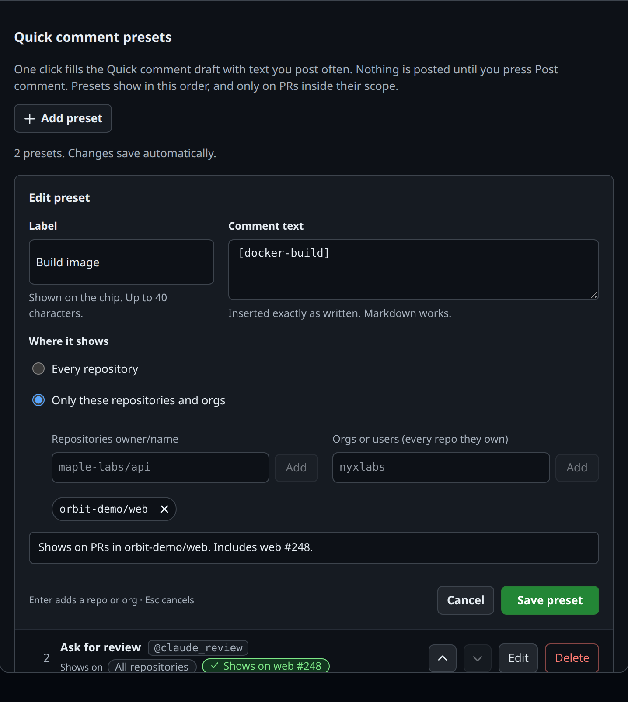
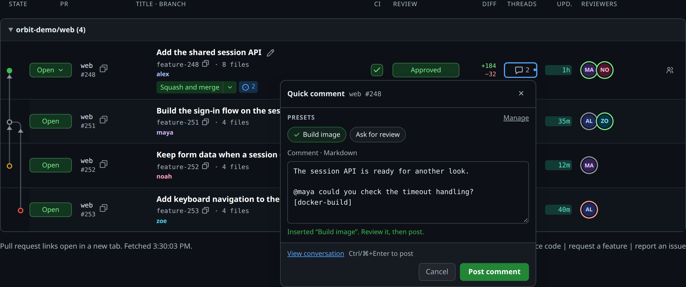

# Quick comment presets

A preset puts reusable text into a pull request’s comment draft. For example, you can label `[docker-build]` **Build image** so you don’t have to remember the command. Selecting the preset does **not** post a comment or start CI. You decide when to post.

## 1. Create a preset

Open **Settings** in the local dashboard header. Choose **Create your first preset** (or **+ Add preset** if you already have one). Give it a short, distinct **Label** such as `Build image`. In **Comment text**, enter the exact text you want to insert, including any Markdown, mentions, or bot command. Choose **Add preset** when the scope is right.

## 2. Choose where it appears

Keep **Every repository** for a general comment. For a command that only some projects understand, choose **Only these repositories and orgs**. Type `maple-labs/seedling` under **Repositories** and press Enter or **Add**. Under **Orgs or users (every repo they own)**, add `fern-workshop`. The sentence below the fields previews the result: this preset appears on `maple-labs/seedling` **or** on any repository owned by `fern-workshop`. It won’t appear on `maple-labs/docs`. Names are case-insensitive. Remove a token with its × button.

## 3. Put frequent presets first

Use **↑** and **↓** next to a preset to change its position. The PR composer keeps this order after filtering for the current repo, so put frequently used commands near the top. Close **Settings** when done. If you opened it from **Manage** in a PR composer, you’ll return to that draft.

## 4. Insert, review, and post

1. Open a PR’s **Threads** cell. The **Presets** row shows only presets that match that PR.
2. Select **Build image**. Its body goes into the empty draft, or on a new line after existing text. A checked chip means its exact body is already present; selecting it again won’t duplicate it.
3. When there are many matches, open **More**. Type part of a label or body to filter; Enter selects the first match and Escape closes the filter.
4. Review or edit the draft, then choose **Post comment** or press **Ctrl+Enter** (**⌘+Enter** on macOS). A bot or workflow can only react once the comment is posted to GitHub.

## 5. Edit, delete, or undo

Choose **Manage** in the composer or **Settings** in the header. **Edit** changes the label, body, or scope in place. Choose **Save preset** to keep the edits. If saving fails, the editor keeps your work; choose **Retry**. **Delete** asks for confirmation in the row. After deletion, **Undo** restores the preset at its former position. Editing or deleting a preset never changes a posted GitHub comment.

## Where presets live

Presets are stored per GitHub account beside saved views in the local config selected by `--config`. They are not synced to GitHub. For the JSON shape and the distinction between omitted and empty scope lists, see [Predefined quick comments in the usage guide](usage.md#predefined-quick-comments).
